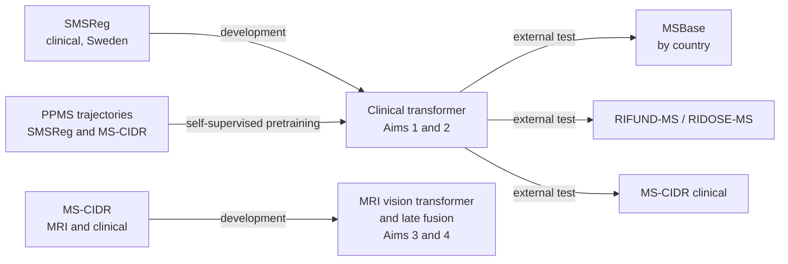

# Data resources: uncertainty-aware clinical and MRI models for multiple sclerosis

This repository describes the data resources behind the DDLS academic PhD project 2026
**"Uncertainty-aware clinical and MRI models for multiple sclerosis disease-course classification and disability worsening"**
([Department of Medical Sciences, Uppsala University](https://www.medsci.uu.se/)).

A printable summary of this repository is available as [`MS_data_resources_overview.pdf`](MS_data_resources_overview.pdf).

> **No individual-level data are stored here.** All figures are aggregate counts taken from published papers,
> manuscripts, approved applications or the data providers' own documentation. Access to every resource is
> governed by its own ethics approvals and data access agreements.

## Resources at a glance

| Resource | Type | Setting | Size | Data used in this project | Role in this project |
|---|---|---|---|---|---|
| [**SMSReg**](datasets/SMSReg.md) ([website](https://neuroreg.se/)) | National clinical registry [[1]](#r1) [[2]](#r2) | Sweden | 24,441 people; 228,192 visits (2025 extract) [[8]](#r8) | Clinical | Main development data for Aims 1 and 2 |
| [**MSBase**](datasets/MSBase.md) ([website](https://www.msbase.org/)) | International clinical registry [[3]](#r3) | 37 countries after curation | 56,578 people; 542,632 visits (after curation) [[9]](#r9) | Clinical | External evaluation only, reported by country |
| [**MS-CIDR**](datasets/MS-CIDR.md) ([website](https://www.progressivemsalliance.org/ms-clinical-and-imaging-data-resource/)) | Pooled clinical-trial resource [[6]](#r6) | 14 trial groups | 13,074 participants; 199,108 clinical visits; 51,978 MRI scans | Clinical and MRI | External clinical test (Aims 1 and 2); MRI and fusion development (Aims 3 and 4) |
| [**RIFUND-MS / RIDOSE-MS**](datasets/RIFUND-RIDOSE.md) | Swedish phase 3 clinical trials [[4]](#r4) [[5]](#r5) | Sweden | ~325 participants; ~2,200 visits; six-year study period | Clinical | External clinical evaluation (Aims 1 and 2) |

## Disease subtypes available

| Resource | RRMS | SPMS | PPMS | Other | Disease-course label |
|---|:---:|:---:|:---:|---|---|
| SMSReg | ✓ | ✓ | ✓ (pretraining only) |  | Clinician-recorded at each visit |
| MSBase | ✓ | ✓ | Not used |  | Clinician-recorded at each visit |
| MS-CIDR | 7,251 | 3,454 | 2,369 (pretraining only) |  | Subtype at trial entry, not an observed transition label |
| RIFUND-MS / RIDOSE-MS | ✓ | None |  | CIS (RIFUND-MS) | Trial population |

RRMS/SPMS classification and confirmed disability worsening (CDW) models use only RRMS and SPMS patients.
PPMS data are used only for self-supervised pretraining, and only from SMSReg and MS-CIDR.

## Data allocation by aim

| Resource | Aim 1: clinical model, RRMS/SPMS | Aim 2: clinical model, CDW | Aim 3: MRI and clinical-MRI fusion, RRMS/SPMS | Aim 4: MRI and fusion, CDW |
|---|---|---|---|---|
| SMSReg | Development; internal test; chronology sensitivity | Development; internal test; chronology sensitivity | Not used | Not used |
| MSBase | External evaluation by country | External evaluation (additional permission being sought) | Not used | Not used |
| MS-CIDR | External clinical test | External clinical test | MRI and fusion development | MRI and fusion development (MS-CIDR partitions from Aim 3) |
| RIFUND-MS / RIDOSE-MS | External clinical evaluation | External evaluation where event counts permit | Clinical pretraining, only after the Aim 1 and 2 evaluations | Clinical pretraining, only after the Aim 1 and 2 evaluations |

## Shared principles across datasets

| Principle | Implementation |
|---|---|
| No leakage between datasets | Patient-disjoint training, calibration and test splits; SMSReg participants linked to RIFUND-MS / RIDOSE-MS are excluded from Aim 1 and 2 development |
| Uncertainty | Probability calibration and conformal prediction [[7]](#r7) |
| Monitoring | Sequential drift monitoring |
| Explainability | Integrated gradients |
| Outcome definition | CDW defined following Müller et al. (2025) in all sources [[10]](#r10) |
| Deployment | Models deployed on [SciLifeLab Serve](https://serve.scilifelab.se/), as for the earlier [MSP-Tracker](https://msp-tracker.serve.scilifelab.se/) [[7]](#r7) |
| Data handling | Pseudonymised or anonymised data in secure, access-controlled storage; no access to re-identification keys |

## Project team

| Role | Name |
|---|---|
| Main supervisor | Joachim Burman |
| Co-supervisors | Kim Kultima, Ola Spjuth, Akshai Parakkal Sreenivasan |
| MSBase collaborator | Tomas Kalincik |
| RIFUND-MS / RIDOSE-MS collaborator | Anders Svenningsson |

## References

1. Andersen O. From the Gothenburg cohort to the Swedish multiple sclerosis registry. *Acta Neurol Scand.* 2012;126(Suppl 195):13–19. [doi:10.1111/ane.12023](https://doi.org/10.1111/ane.12023)

2. Hillert J, Stawiarz L. The Swedish MS registry: clinical support tool and scientific resource. *Acta Neurol Scand.* 2015;132(Suppl 199):11–19. [doi:10.1111/ane.12425](https://doi.org/10.1111/ane.12425) · [PubMed 26046553](https://pubmed.ncbi.nlm.nih.gov/26046553/)

3. Butzkueven H, Chapman J, Cristiano E, et al. MSBase: an international, online registry and platform for collaborative outcomes research in multiple sclerosis. *Mult Scler.* 2006;12(6):769–774. [doi:10.1177/1352458506070775](https://doi.org/10.1177/1352458506070775) · [PubMed 17263005](https://pubmed.ncbi.nlm.nih.gov/17263005/)

4. Svenningsson A, Frisell T, Burman J, et al. Safety and efficacy of rituximab versus dimethyl fumarate in patients with relapsing-remitting multiple sclerosis or clinically isolated syndrome in Sweden: a rater-blinded, phase 3, randomised controlled trial. *Lancet Neurol.* 2022;21(8):693–703. [doi:10.1016/S1474-4422(22)00209-5](https://doi.org/10.1016/S1474-4422(22)00209-5) · [PubMed 35841908](https://pubmed.ncbi.nlm.nih.gov/35841908/) · [NCT02746744](https://clinicaltrials.gov/study/NCT02746744)

5. RItuximab Long-Term DOSE Trial in Multiple Sclerosis (RIDOSE-MS). ClinicalTrials.gov [NCT03979456](https://clinicaltrials.gov/study/NCT03979456).

6. International Progressive MS Alliance. MS Clinical and Imaging Data Resource. [progressivemsalliance.org](https://www.progressivemsalliance.org/ms-clinical-and-imaging-data-resource/)

7. Sreenivasan AP, Vaivade A, Noui Y, Khoonsari PE, Burman J, Spjuth O, Kultima K. Conformal prediction enables disease course prediction and allows individualized diagnostic uncertainty in multiple sclerosis. *NPJ Digit Med.* 2025;8:224. [doi:10.1038/s41746-025-01616-z](https://doi.org/10.1038/s41746-025-01616-z) · [PubMed 40275055](https://pubmed.ncbi.nlm.nih.gov/40275055/)

8. Sreenivasan AP, Noui Y, Erngren I, Spjuth O, Burman J, Kultima K. Prospective validation of an uncertainty-aware machine learning model for secondary progressive multiple sclerosis classification. medRxiv preprint, 2026 (under revision). [doi:10.64898/2026.10.07.26364939](https://doi.org/10.64898/2026.10.07.26364939)

9. Sreenivasan AP, et al. HARMONISE: an uncertainty-aware framework for harmonising disease-course predictions across international clinical registries. Manuscript.

10. Müller J, Sharmin S, Lorscheider J, et al. Standardized definition of progression independent of relapse activity (PIRA) in relapsing-remitting multiple sclerosis. *JAMA Neurol.* 2025;82(6):614–625. [doi:10.1001/jamaneurol.2025.0495](https://doi.org/10.1001/jamaneurol.2025.0495) · [PubMed 40227706](https://pubmed.ncbi.nlm.nih.gov/40227706/)
